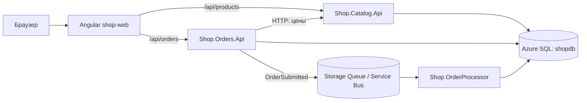

# Курс: учебный интернет-магазин в Microsoft Azure

Цель курса — шаг за шагом развернуть в Azure набор приложений на .NET 10 и Angular:
виртуальную сеть, базу данных, API, фронтенд и очереди. Сначала всё создаётся вручную
(Portal + Azure CLI), чтобы понять, как это устроено. Потом то же самое описывается в Terraform.
В конце приложение запускается в Kubernetes (AKS) и разворачивается через GitHub Actions.

## Приложение

| Папка | Что внутри |
|-------|-----------|
| `src/Shop.Catalog.Api` | Каталог товаров (Minimal API, EF Core, схема `catalog`) |
| `src/Shop.Orders.Api` | Создание и просмотр заказов, отправка сообщения в очередь |
| `src/Shop.OrderProcessor` | Фоновая обработка заказов из очереди (+ `/health`) |
| `src/Shop.Orders.Data` | `OrdersDbContext` и миграции — общие для Orders API и Processor |
| `src/Shop.Shared` | Контракты сообщений, клиенты очередей, телеметрия |
| `src/shop-web` | Angular 21: каталог, корзина, список заказов |
| `src/docker-compose.yml` | Локальный стенд: SQL Server + Azurite + все сервисы |
| `src/infra/terraform` | Terraform: `bootstrap`, `modules`, `envs/paas`, `envs/aks` |
| `src/infra/k8s` | Манифесты Kubernetes (kustomize) |
| `.github/workflows` | CI и деплой в AKS |

## Уроки

| № | Урок | Платные ресурсы |
|---|------|-----------------|
| 00 | [Защита от расходов](00-cost-protection.md) | нет |
| 01 | [Инструменты](01-tools.md) | нет |
| 02 | [Основы Azure](02-azure-basics.md) | нет |
| 03 | [Приложение локально](03-local-run.md) | нет |
| 04 | [Виртуальная сеть (VNet)](04-vnet.md) | нет |
| 05 | [Azure SQL Database](05-azure-sql.md) | Private Endpoint |
| 06 | [API в App Service](06-app-service.md) | App Service B1 |
| 07 | [Фронтенд в Static Web Apps](07-static-web-apps.md) | нет (Free) |
| 08 | [Очереди: Azure Storage Queues](08-storage-queues.md) | копейки |
| 09 | [Очереди: Azure Service Bus](09-service-bus.md) | копейки |
| 10 | [Мониторинг](10-monitoring.md) | в пределах лимита |
| 11 | [Terraform: основы](11-terraform-basics.md) | копейки |
| 12 | [Terraform: вся инфраструктура](12-terraform-paas.md) | как 04–10 |
| 13 | [Контейнеры и ACR](13-containers-acr.md) | ACR Basic |
| 14 | [AKS через Terraform](14-aks.md) | AKS, LB, IP |
| 15 | [CI/CD в GitHub Actions](15-cicd.md) | как в 14 |

## Правила прохождения

1. **Урок 00 обязателен до создания любых ресурсов.** Подписка — **Free Trial**: кредит действует 30 дней,
   поэтому уроки с облачными ресурсами (04–15) лучше пройти в этот срок (план — в уроке 00).
2. Команды даны для **PowerShell** (Windows). Перенос строки — обратный апостроф `` ` ``.
3. Уроки 04–10 работают в одной группе `rg-shop-manual`. Переменные — в [scripts/env.ps1](scripts/env.ps1):
   в начале каждого занятия выполните `. .\Study\scripts\env.ps1` из корня репозитория.
4. Каждый урок заканчивается разделом **«Очистка»**. Не пропускайте его.
5. Если сомневаетесь, что что-то осталось, — запустите [scripts/cleanup.ps1](scripts/cleanup.ps1).

## Формат урока

Цель → теория → шаги (Portal и/или CLI) → проверка → очистка → вопросы для самопроверки.
