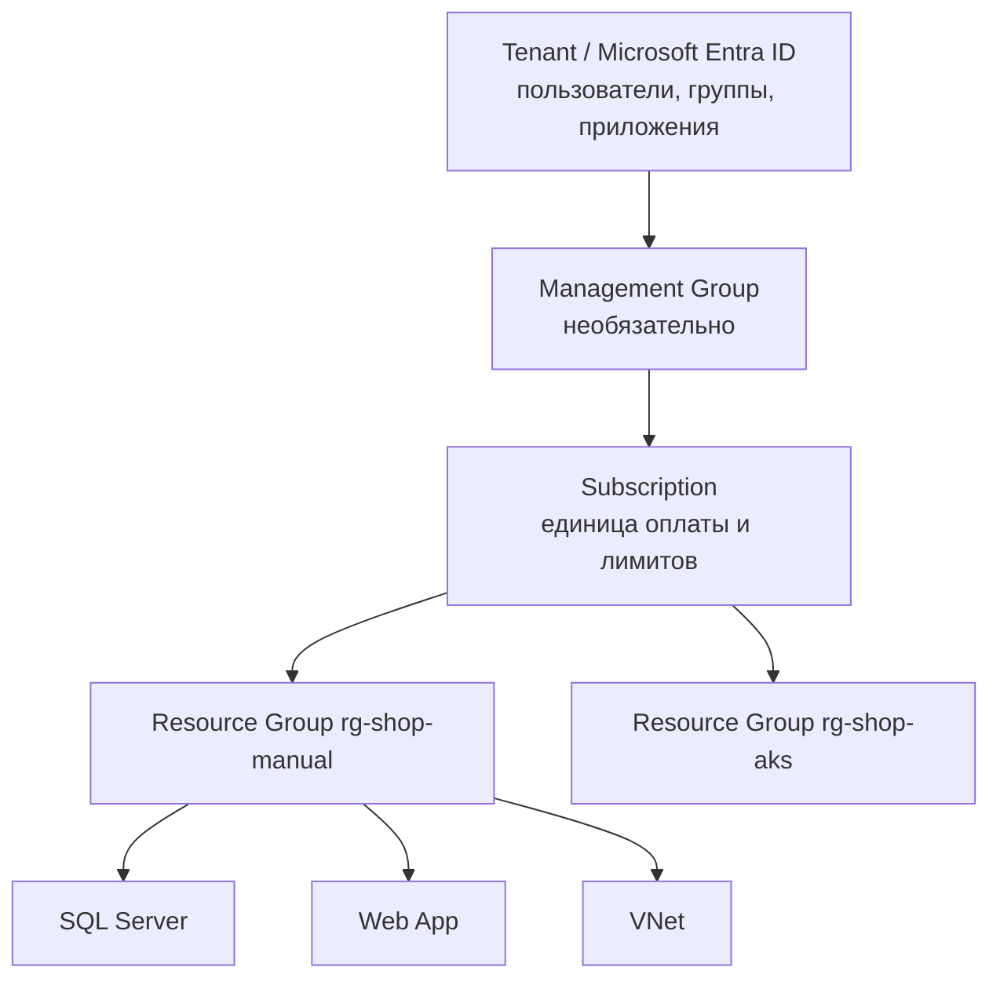

# Урок 02. Основы Azure

## Цель
Понять базовые понятия, на которых держится всё остальное.

## Иерархия



- **Tenant (Entra ID)** — каталог пользователей. Ваша учётная запись живёт здесь.
- **Subscription** — «счёт», к которому привязываются расходы и квоты.
- **Resource Group** — логический контейнер. Удалили группу → удалились все ресурсы в ней.
- **Resource** — конкретный сервис (база, сайт, сеть).
- **Region** — датацентр (`swedencentral`). Ресурсы группы могут быть в разных регионах.

## Идентификаторы ресурсов

```
/subscriptions/<sub-id>/resourceGroups/rg-shop-manual/providers/Microsoft.Sql/servers/sql-shop-abc12
```
Этот путь используют CLI, Terraform и RBAC (права выдаются на «scope» — любой уровень пути).

## Доступ: RBAC и Managed Identity

- **RBAC** — роль + кому + на что (scope). Пример: «Storage Queue Data Contributor» для Web App на Storage Account.
- **Control plane** (создать/удалить ресурс) и **data plane** (прочитать сообщение из очереди) — разные роли.
  Owner подписки **не** может читать очередь, пока не получит data-роль.
- **Managed Identity** — учётная запись Entra ID для приложения. Приложение получает токен
  без паролей. В коде это `DefaultAzureCredential` (см. `src/Shop.Shared/Messaging`).
  - *System-assigned* — живёт и умирает вместе с ресурсом (используем в App Service).
  - *User-assigned* — отдельный ресурс, можно привязать к нескольким сервисам (используем в AKS).

> В курсе **нет паролей и ключей** в настройках Azure-приложений: SQL, очереди и ACR — через Managed Identity.

## Теги
Метки `ключ=значение` на ресурсах. Используем `course=azure-learning` для отчётов о расходах и очистки.

## Практика (бесплатно)

```powershell
# Создаём и сразу удаляем пустую группу — это бесплатно
az group create -n rg-shop-hello -l swedencentral --tags course=azure-learning
az group show -n rg-shop-hello --query id -o tsv
az role assignment list --assignee (az ad signed-in-user show --query id -o tsv) --all -o table
az group delete -n rg-shop-hello --yes
```

Откройте Portal → **Resource groups** и посмотрите, что группа появилась и исчезла.
Откройте **Activity log** подписки — там видна история операций.

## Как читать цены
1. https://azure.microsoft.com/pricing/calculator/ → добавьте **App Service** → регион Sweden Central → Linux → B1.
2. Обратите внимание на «per hour» и «per month (730 h)».
3. Сравните с **F1 (Free)** — почему мы его не используем: нет VNet Integration и Always On.

## Очистка
`az group list -o table` — группы `rg-shop-hello` быть не должно.

## Вопросы для самопроверки
1. Чем Subscription отличается от Resource Group?
2. Почему Owner подписки не может прочитать сообщение из очереди без дополнительной роли?
3. Чем system-assigned identity отличается от user-assigned?
