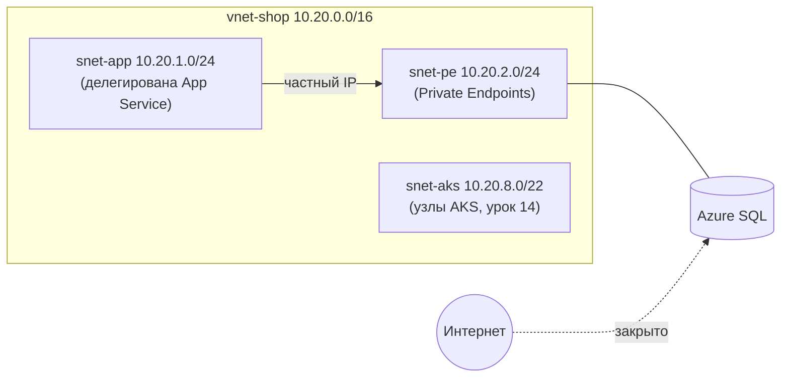

# Урок 04. Виртуальная сеть (VNet)

## Цель
Создать частную сеть, в которой будут жить приложения и через которую они будут ходить в базу данных
без выхода в интернет.

## Теория



| Понятие | Что это |
|---|---|
| **VNet** | Изолированная сеть с вашим диапазоном адресов (CIDR). Бесплатна |
| **Subnet** | Часть диапазона VNet. Azure резервирует 5 адресов в каждой подсети |
| **NSG** (Network Security Group) | Firewall на уровне подсети/сетевой карты: правила allow/deny по IP, порту, протоколу |
| **Delegation** | Подсеть отдаётся конкретному сервису (например, App Service для VNet Integration) |
| **Service Endpoint** | Трафик к PaaS идёт по магистрали Azure, но сервис остаётся с **публичным** адресом. Бесплатно |
| **Private Endpoint** | У PaaS-сервиса появляется **частный IP в вашей подсети**. Публичный доступ можно закрыть. Платно (~0.01 USD/ч) |
| **Private DNS Zone** | `privatelink.database.windows.net` — чтобы имя `sql-xxx.database.windows.net` внутри VNet резолвилось в частный IP |
| **VNet Integration** | Исходящий трафик App Service идёт через вашу VNet (входящий — по-прежнему публичный) |
| **Peering** | Соединение двух VNet. Только теория — трафик платный |
| **VPN Gateway / ExpressRoute** | Связь с офисом/домом. **Только теория** — от ~140 USD/мес |

### Планирование адресов
- Не пересекайтесь с домашней сетью (192.168.x.x) и с сетями Docker/Kubernetes.
- Берите с запасом: `/16` для VNet, `/24` для подсетей, `/22` для AKS.

## Практика

Сначала создайте сеть **через Portal**, чтобы увидеть все параметры, затем — то же самое через CLI
(или удалите созданное в Portal и повторите командами).

### Вариант A: Portal

1. **Resource groups → Create**: Subscription — ваша, Resource group — `rg-shop-manual`, Region — **Sweden Central**.
   Вкладка **Tags**: `course` = `azure-learning`. **Review + create → Create**.
2. **Virtual networks → Create**:
   - **Basics**: Resource group `rg-shop-manual`, Name `vnet-shop`, Region **Sweden Central**.
   - **Security**: ничего не включайте (Bastion, Firewall, DDoS Protection — **платные**, от десятков до тысяч USD/мес).
   - **IP addresses**: замените адресное пространство по умолчанию (`10.0.0.0/16`) на `10.20.0.0/16`.
     Удалите подсеть `default` и добавьте:
     - `snet-app` — `10.20.1.0/24`, **Subnet delegation**: `Microsoft.Web/serverFarms`;
     - `snet-pe` — `10.20.2.0/24`.
   - **Tags**: `course` = `azure-learning`.
   - **Review + create → Create**.
3. **Network security groups → Create**: `nsg-shop-default` в той же группе. Затем в NSG → **Subnets → Associate**
   привяжите его к `snet-app` и `snet-pe`.

> **«No results were found» в поле Resource group или Virtual network** в мастере создания другого сервиса
> означает, что этих ресурсов ещё нет (или выбрана не та подписка/регион). Создайте их (шаги выше),
> затем закройте и заново откройте мастер — они появятся в выпадающих списках.

### Вариант Б: Azure CLI

```powershell
. .\Study\scripts\env.ps1     # из корня репозитория
$TAGS = "course=azure-learning"

az group create -n $RG -l $LOC --tags $TAGS

az network vnet create -g $RG -n $VNET --address-prefixes 10.20.0.0/16 --tags $TAGS

az network vnet subnet create -g $RG --vnet-name $VNET -n snet-app `
  --address-prefixes 10.20.1.0/24 --delegations Microsoft.Web/serverFarms

az network vnet subnet create -g $RG --vnet-name $VNET -n snet-pe `
  --address-prefixes 10.20.2.0/24

az network nsg create -g $RG -n nsg-shop-default --tags $TAGS
az network vnet subnet update -g $RG --vnet-name $VNET -n snet-app --network-security-group nsg-shop-default
az network vnet subnet update -g $RG --vnet-name $VNET -n snet-pe  --network-security-group nsg-shop-default
```

### Посмотрите в Portal
1. **rg-shop-manual → vnet-shop → Subnets** — делегирование у `snet-app`.
2. **nsg-shop-default → Inbound security rules** — правила по умолчанию:
   `AllowVnetInBound`, `AllowAzureLoadBalancerInBound`, `DenyAllInBound`. Приоритет: меньше число — выше приоритет.
3. Попробуйте добавить правило (и удалить):
   ```powershell
   az network nsg rule create -g $RG --nsg-name nsg-shop-default -n deny-rdp `
     --priority 200 --direction Inbound --access Deny --protocol Tcp --destination-port-ranges 3389
   az network nsg rule list -g $RG --nsg-name nsg-shop-default -o table
   az network nsg rule delete -g $RG --nsg-name nsg-shop-default -n deny-rdp
   ```

## Проверка
```powershell
az network vnet subnet list -g $RG --vnet-name $VNET --query "[].{name:name, prefix:addressPrefix, nsg:networkSecurityGroup.id!=null}" -o table
```

## Очистка
VNet, подсети и NSG **бесплатны** — оставьте их для уроков 05–10.
Если делаете перерыв больше недели — можно удалить всю группу: `az group delete -n $RG --yes`.

## Вопросы для самопроверки
1. Чем Private Endpoint отличается от Service Endpoint?
2. Зачем нужна Private DNS Zone?
3. Почему подсеть App Service должна быть делегирована?
4. Влияет ли VNet Integration на входящий трафик к Web App?
