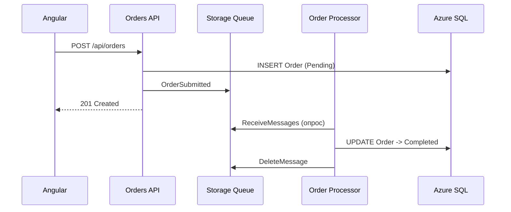

# Урок 08. Очереди: Azure Storage Queues

## Цель
Подключить очередь заказов: Orders API отправляет сообщение, Order Processor обрабатывает.

## Теория
- **Storage Queue** — простая очередь внутри Storage Account. Сообщение до 64 KB, хранение до 7 дней (по умолчанию).
- Платим за хранение (копейки) и транзакции (~0.0004 USD за 10 000). Наш обработчик опрашивает очередь
  раз в 5 секунд, когда она пуста, — это ~17 000 транзакций в сутки, т.е. < 0.001 USD.
- **Visibility timeout**: получатель «забирает» сообщение на время обработки; если не удалил — оно вернётся.
  Это гарантия **at-least-once**: сообщение может прийти повторно → обработка должна быть идемпотентной.
- **DequeueCount** + **poison queue**: после 5 неудачных попыток наш обработчик кладёт сообщение в `orders-poison`
  (см. `StorageQueueOrderListener.cs`).
- Доступ — роль **Storage Queue Data Contributor** для Managed Identity.



## 1. Storage Account и очереди

```powershell
. .\Study\scripts\env.ps1

az storage account create -g $RG -n $STORAGE -l $LOC --sku Standard_LRS --kind StorageV2 `
  --min-tls-version TLS1_2 --allow-blob-public-access false --tags course=azure-learning

$ST_ID = az storage account show -g $RG -n $STORAGE --query id -o tsv

# Себе — права на данные, чтобы работать с очередью по Entra ID (без ключей):
az role assignment create --assignee $ME_ID --role "Storage Queue Data Contributor" --scope $ST_ID

az storage queue create --account-name $STORAGE -n orders --auth-mode login
az storage queue create --account-name $STORAGE -n orders-poison --auth-mode login
```

> Назначение роли вступает в силу через 1–5 минут. Если ошибка `AuthorizationPermissionMismatch` — подождите.

## 2. Доступ приложений

```powershell
foreach ($app in $APP_ORDERS, $APP_PROCESSOR) {
  $pid_ = az webapp identity show -g $RG -n $app --query principalId -o tsv
  az role assignment create --assignee-object-id $pid_ --assignee-principal-type ServicePrincipal `
    --role "Storage Queue Data Contributor" --scope $ST_ID
  az webapp config appsettings set -g $RG -n $app --settings `
    "Messaging__Provider=StorageQueue" `
    "Messaging__StorageQueue__ServiceUri=https://$STORAGE.queue.core.windows.net"
}
```

## Проверка

1. Откройте фронтенд (урок 07) → оформите заказ → «Заказы»: `Pending` → `Completed`.
2. Остановите обработчик и посмотрите, как копятся сообщения:
   ```powershell
   az webapp stop -g $RG -n $APP_PROCESSOR
   # создайте 2-3 заказа во фронтенде
   az storage message peek --account-name $STORAGE -q orders --num-messages 10 --auth-mode login -o table
   az webapp start -g $RG -n $APP_PROCESSOR
   ```
3. Portal → Storage Account → **Queues** → `orders` — просмотр сообщений в браузере.

## Упражнение: poison-сообщение
Отправьте «битое» сообщение (обработчик ожидает Base64 JSON):
```powershell
$bad = [Convert]::ToBase64String([Text.Encoding]::UTF8.GetBytes('{"orderId":"not-a-guid"}'))
az storage message put --account-name $STORAGE -q orders --content $bad --auth-mode login
```
Через ~5 минут (5 попыток × 60 с visibility timeout) оно окажется в `orders-poison`. Логи:
`az webapp log tail -g $RG -n $APP_PROCESSOR`.

## Очистка
Storage Account почти бесплатен — оставьте до урока 10.

## Вопросы для самопроверки
1. Что такое at-least-once и как это учтено в `OrderProcessingService`?
2. Что произойдёт с заказом, если сохранение в БД прошло, а отправка в очередь — нет? (Подсказка: паттерн *Transactional Outbox*.)
3. Почему обработчику нужна роль Contributor, а не только Reader?
