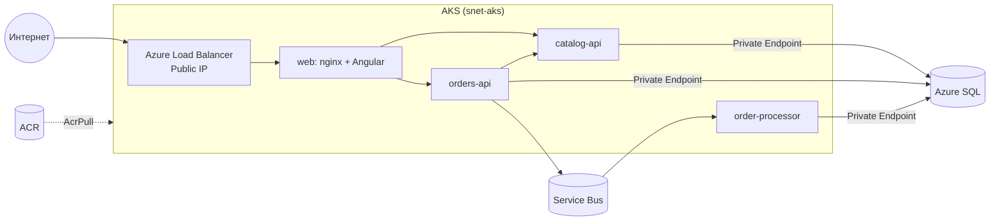

# Урок 14. AKS через Terraform

## Цель
Развернуть магазин в Azure Kubernetes Service: кластер в своей VNet, образы из ACR, доступ к SQL и Service Bus
через Workload Identity. **Сразу после занятия — `terraform destroy`.**

## ⚠ Стоимость
Стенд стоит **~0.1 USD/час** (узел B2s, диск, Standard Load Balancer, Public IP, SQL Basic, Private Endpoint, ACR).
Сессия 3 часа ≈ 0.3 USD. **Забытый на месяц стенд ≈ 70 USD.** Поставьте себе напоминание.

## Теория



| Понятие Kubernetes | Что это |
|---|---|
| **Node** | ВМ, на которой запускаются контейнеры (у нас 1 × Standard_B2s) |
| **Pod** | Один или несколько контейнеров с общим IP |
| **Deployment** | Описывает желаемое число подов и образ; сам пересоздаёт упавшие |
| **Service (ClusterIP)** | Стабильное внутреннее DNS-имя (`catalog-api`) для набора подов |
| **Service (LoadBalancer)** | Публичный IP через Azure Load Balancer |
| **ConfigMap** | Настройки (переменные окружения) |
| **ServiceAccount + Workload Identity** | Под получает токен Entra ID для user-assigned identity — без секретов |
| **Ingress / Gateway API** | HTTP-маршрутизация на L7. Мы обходимся nginx внутри `web` — меньше компонентов и затрат |

Решения для экономии: **Free tier** control plane, **1 узел B2s**, **Azure CNI Overlay** (подам не нужны IP из VNet),
нет Container Insights (можно включить, но это расход на Log Analytics).

## 1. Инфраструктура

```powershell
cd src\infra\terraform\envs\aks
Copy-Item terraform.tfvars.example terraform.tfvars   # заполните как в уроке 12
Copy-Item ..\paas\backend.hcl backend.hcl
terraform init -backend-config=backend.hcl
terraform plan -out tfplan
terraform apply tfplan     # ~10 минут
terraform output
```

> Если ошибка квоты/размера `Standard_B2s` недоступен в регионе: `az vm list-skus -l swedencentral --size Standard_B2 -o table`
> и задайте `node_vm_size` в `terraform.tfvars` (например, `Standard_B2s_v2`).

## 2. Пользователь SQL для Workload Identity

```powershell
terraform output -raw sql_create_users_script
```
Выполните в Query editor базы `shopdb`.

## 3. Образы

```powershell
$ACR = terraform output -raw acr_name
Push-Location ..\..\..\..     # src
foreach ($p in @{p="Shop.Catalog.Api";i="shop-catalog-api"}, @{p="Shop.Orders.Api";i="shop-orders-api"}, @{p="Shop.OrderProcessor";i="shop-order-processor"}) {
  az acr build -r $ACR -t "$($p.i):v1" --build-arg PROJECT=$($p.p) -f Dockerfile .
}
az acr build -r $ACR -t shop-web:v1 ./shop-web
Pop-Location
```

## 4. Подключение kubectl

```powershell
az aks get-credentials -g (terraform output -raw resource_group_name) -n (terraform output -raw aks_name) --overwrite-existing
kubectl get nodes -o wide
kubectl get pods -A
```

## 5. Манифесты

Откройте [src/infra/k8s/kustomization.yaml](../src/infra/k8s/kustomization.yaml) и замените плейсхолдеры:

| Плейсхолдер | Значение |
|---|---|
| `<ACR_LOGIN_SERVER>` | `terraform output -raw acr_login_server` |
| `<SQL_SERVER_FQDN>` | `terraform output -raw sql_server_fqdn` |
| `<SERVICEBUS_NAMESPACE>.servicebus.windows.net` | `terraform output -raw servicebus_fqdn` |
| `<STORAGE_ACCOUNT>` | `terraform output -raw storage_account_name` |
| `<WORKLOAD_IDENTITY_CLIENT_ID>` | `terraform output -raw workload_identity_client_id` |

> Не коммитьте эти значения — после урока выполните `git restore src/infra/k8s/kustomization.yaml`.
> (Они не секретны, но в репозитории должен оставаться шаблон.)

```powershell
cd <репозиторий>
kubectl kustomize src/infra/k8s       # посмотреть итоговый YAML
kubectl apply -k src/infra/k8s
kubectl -n shop get pods -w           # Ctrl+C, когда все Running
kubectl -n shop get svc web           # EXTERNAL-IP появится через 1–2 минуты
```

Откройте `http://<EXTERNAL-IP>` → оформите заказ.

## 6. Исследование

```powershell
kubectl -n shop logs deploy/order-processor -f
kubectl -n shop describe pod -l app=orders-api          # события, probes, env
kubectl -n shop exec deploy/orders-api -- env | Select-String AZURE_   # переменные Workload Identity
kubectl -n shop scale deploy/catalog-api --replicas=2
kubectl -n shop delete pod -l app=catalog-api           # Deployment поднимет новые
kubectl -n shop rollout restart deploy/orders-api
kubectl top nodes                                       # нагрузка на узел
```

В Portal: **AKS → Workloads / Services and ingresses** — те же объекты в UI.
Группа `MC_rg-shop-aks_aks-shop_swedencentral` — ресурсы, которыми управляет AKS (ВМ, диск, LB, IP). Не трогайте её руками.

## 7. (Дополнительно) Остановить кластер вместо удаления

```powershell
az aks stop -g rg-shop-aks -n aks-shop    # узлы освобождаются, платите за диск/IP/SQL/ACR ~0.04 USD/ч
az aks start -g rg-shop-aks -n aks-shop
```
Но надёжнее — `destroy`: Terraform воссоздаст всё за ~10 минут.

## Очистка — обязательно

```powershell
kubectl delete -k src/infra/k8s           # удалит Load Balancer IP быстрее
cd src\infra\terraform\envs\aks
terraform destroy
az group list -o table                    # rg-shop-aks и MC_* должны исчезнуть
git restore ..\..\..\k8s\kustomization.yaml
```

## Вопросы для самопроверки
1. Чем Service типа ClusterIP отличается от LoadBalancer?
2. Как под получает токен для Service Bus без секрета? Какие объекты в этом участвуют?
3. Что произойдёт, если удалить под вручную? А узел?
4. Почему мы не использовали Ingress Controller?
